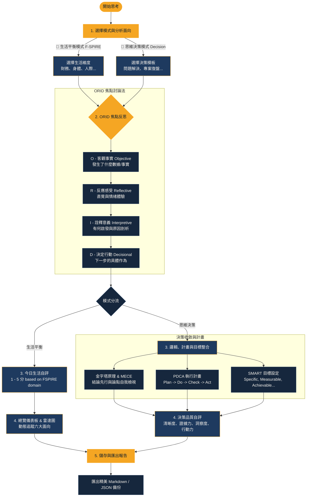

# 🧭 ORID 焦點討論與決策羅盤 (ORID Mindset & Decision Compass)

一個將「感性反思 (ORID)」、「邏輯論證 (Pyramid/MECE)」、「敏捷執行 (PDCA)」與「目標設定 (SMART)」無縫整合的單檔案 Web 工具，支援**中英雙語（繁體中文 / English）**切換，旨在協助使用者在日常生活中進行多維度的平衡管理與嚴謹的決策推演。

---

## 🗺️ 羅盤思考與行動決策流程 (Workflow)

以下是本工具的完整運作流程。它整合了反射性思維、邏輯架構、執行循環與目標檢核：

---

## 🚀 核心功能特色 (Key Features)

### 1. 雙模式自由切換
- **生活平衡模式 (🌟 Life)**: 基於 **F-SPIRE** 框架（財務 Financial、靈性 Spiritual、身體 Physical、智識 Intellectual、關係 Relational、情緒 Emotional），幫助您檢視生活各面向的平衡狀態，結合 **4M / 4F / 6P** 跨模型提示。
- **思維決策模式 (🧠 Decision)**: 提供多種思維模板（問題解決、專案復盤、職涯決策、讀書學習、斯多葛反思、每週回顧），著重於邏輯推演、深度剖析與行動轉化。

### 2. 中英雙語即時切換 (🌐 Bilingual Interface)
- 支援一鍵無縫切換 **繁體中文 (Traditional Chinese)** 與 **英文 (English)**。
- 涵蓋所有引導問題、金字塔/MECE/PDCA/SMART 表單提示、決策指標、說明指南、互動流程圖與 Markdown 匯出報告。

### 3. ORID 焦點討論引導
內建階梯式引導，幫助您從客觀事實出發，經過情緒反思與因果詮釋，最後落實到具體決策（Objective ➔ Reflective ➔ Interpretive ➔ Decisional），避免思考失焦或流於發洩。

### 4. 金字塔原理與 MECE 論證
在決策模式下，提供結構化收斂工具：
- **結論先行**: 提煉核心決策/結論建議（Key Message）。
- **MECE 結構**: 拆解支持論點，確保「相互獨立，完全窮盡」（Mutually Exclusive and Collectively Exhaustive）。
- **邏輯檢視**: 提供雙重檢視清單，確保推論嚴謹。

### 5. PDCA 執行計畫與 D 連結
將 ORID 的 **D（決定行動）** 進一步細化為 Plan (計畫) ➔ Do (執行) ➔ Check (度量查核) ➔ Act (改善調整) 的專案循環，確保決策不止停留在紙上，更能敏捷落地並持續改進。

### 6. SMART 原則目標設定
提供 **SMART 目標檢核工具**（Specific 明確、Measurable 可衡量、Achievable 可達成、Relevant 相關、Time-bound 時限），將行動計畫與 PDCA 目標具體化，確保目標易於追蹤與驗收。

### 7. 決策品質 (DQ) 評估與雷達圖看板
- **自評機制**: 從「清晰度、事實證據、洞察深度、可執行性」四維度評分，生成決策品質指數。
- **多維看板**: 自動統計各面向數據，以精美的 SVG 多維雷達圖直觀呈現生活平衡狀態與決策品質。

### 8. 本地保存與 Markdown 匯出
- 數據完全保存在您的瀏覽器本地（LocalStorage），安全隱密。
- 支持備份 JSON 數據，或一鍵匯出排版精美的結構化 Markdown 決策與反思報告，方便無縫導入至 Obsidian、Notion 或 Logseq 等個人知識管理庫。

---

## 🌐 GitHub Pages 線上部署與使用 (Live Demo)

本專案已完全相容 **GitHub Pages**，無需任何伺服器或建置步驟：

- **🔗 線上即用網址 (Live Demo)**：
  👉 **https://sinliongtoo.github.io/fspire_ordid_retrospective/**

### 啟用步驟說明 (How to Enable)
1. 進入該儲存庫的 **Settings (設定)** ➔ 左側選單點擊 **Pages**。
2. 在 **Build and deployment** 下的 **Branch** 選擇 `master` 分支與 `/(root)` 目錄。
3. 點擊 **Save (儲存)**。
4. 約 30 秒至 1 分鐘後即可在全球直接透過上方網址在線使用！

---

## 🛠️ 本機離線使用方式 (Offline Usage)

若不想部署至網路，亦可直接於本機離線開啟：

1. 定位到專案目錄中的 [index.html](file:///c:/Users/tu-hs/OneDrive/文件/2022_0308_MASA/2022-0708/Projects_antigravity/ORID_discuss/index.html) 或 [orid_life_compass.html](file:///c:/Users/tu-hs/OneDrive/文件/2022_0308_MASA/2022-0708/Projects_antigravity/ORID_discuss/orid_life_compass.html)。
2. 在您的電腦上**按兩下開啟**該 HTML 檔案（使用 Chrome、Edge、Safari 或 Firefox 等任何現代瀏覽器）。
3. 即可在瀏覽器中開始使用所有功能！

---

## 📂 專案檔案清單 (Files)

- [index.html](file:///c:/Users/tu-hs/OneDrive/文件/2022_0308_MASA/2022-0708/Projects_antigravity/ORID_discuss/index.html): **GitHub Pages 根目錄入口檔案**（完整支援雙模式、雙語系、雷達圖、PDCA、SMART 目標設定、金字塔 MECE、歷史紀錄、及互動流程說明分頁）。
- [orid_life_compass.html](file:///c:/Users/tu-hs/OneDrive/文件/2022_0308_MASA/2022-0708/Projects_antigravity/ORID_discuss/orid_life_compass.html): 本地應用程式主檔案（與 `index.html` 保持同步）。
- [orid_pyraidm.html](file:///c:/Users/tu-hs/OneDrive/文件/2022_0308_MASA/2022-0708/Projects_antigravity/ORID_discuss/orid_pyraidm.html): 簡化版的思維決策工作區（早期版本）。
- [fspire-life-manager (1).html](file:///c:/Users/tu-hs/OneDrive/文件/2022_0308_MASA/2022-0708/Projects_antigravity/ORID_discuss/fspire-life-manager%20(1).html): 生活管理與日記備份工具（早期版本）。
